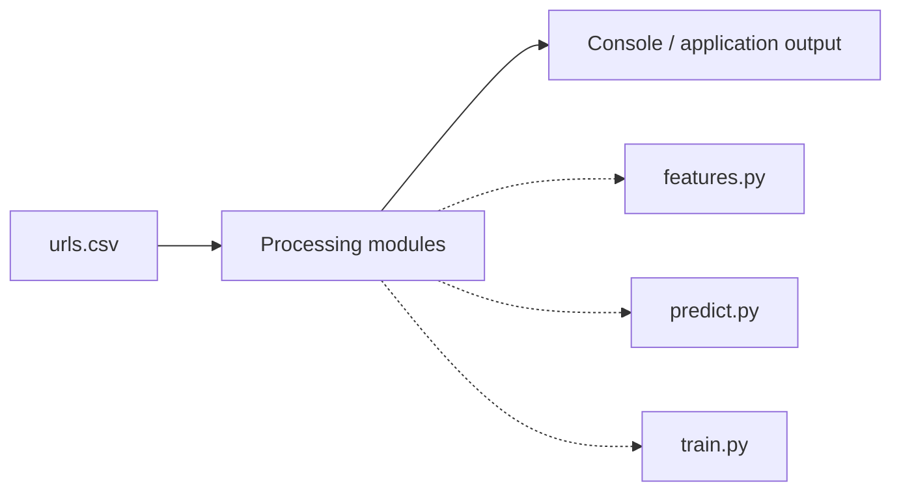

# Architecture — Phishing Url Detector

## Inputs

- `sample/urls.csv`

## Source files

- `src/features.py`
- `src/predict.py`
- `src/train.py`

## Output

This representation is intended for source navigation. It does not imply a production deployment or undisclosed components. The editable diagram is available as [`architecture.mmd`](architecture.mmd).
