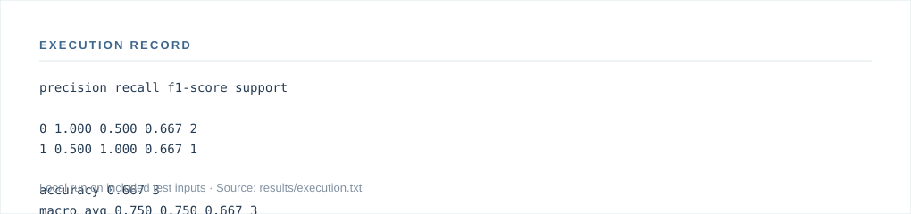

# Execution record — Email Phishing Classifier

**Status:** Local execution completed using bundled fixtures.  
**Python:** 3.13.5  
**Execution time:** 7.53 seconds in the packaging environment (not a standardized benchmark).  
**Method:** `python src/train.py sample/emails.csv --model outputs/model.joblib`, `python src/predict.py outputs/model.joblib "Urgent: verify your account immediately"`

## Observed output

**Raw output:** [execution.txt](../results/execution.txt)  
**Command records and SHA-256 digests:** [execution.json](../results/execution.json)

## Interpretation

Results were computed on the included test fixtures. They demonstrate one successful invocation, not measured generalization, comparative performance, system availability or operational readiness. If the fixtures or application are synthetic, values remain synthetic or simulated.
